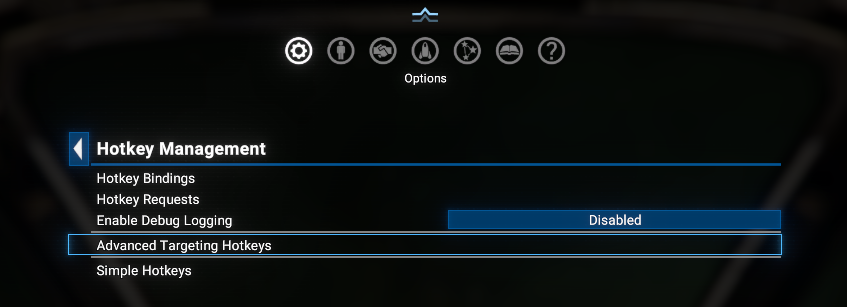
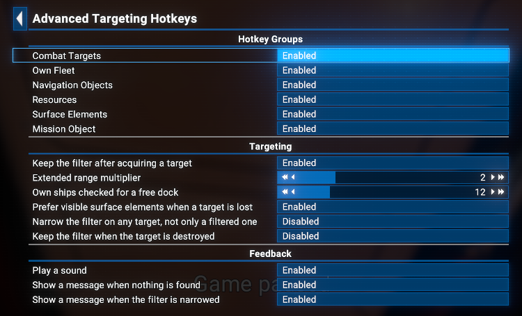

# Advanced Targeting Hotkeys

Filtered target acquisition for X4: Foundations, built on the [Native Hotkey API](https://www.nexusmods.com/x4foundations/mods/2181): every action is bindable in the game's own keybinding UI.

## Overview

Vanilla `Next Target` / `Previous Target` cycle through everything around you. This mod adds a **sticky filter**: each acquisition hotkey targets the nearest matching object and remembers the category, so Next/Previous walk only enemies, stations, or the turrets of the ship you're attacking. Any other target change (a mouse click, a vanilla key, the target leaving the sector) drops the filter.

**Narrow Filter to Selected Type** pins the filter to the exact type of the current target: one turret model on a destroyer, or one ship type in a mixed wing.

### Auto-switch when target is lost

For enemies, missiles, collectables and surface elements, a target that is destroyed, collected or no longer hostile (pilot bailed out) is replaced by the next one in the list:

- Surface elements prefer one in line of sight (can be switched off).
- When the last element of a kind is gone, you get the hull itself.
- With nothing left, the target is left alone, silently.

Other categories drop the filter when the target dies, unless **Keep the filter when the target is destroyed** is on.

## Requirements

- **X4: Foundations**: Version **8.00** or higher.
- **Native Hotkey API** by Chem O`Dun, version **8.00.07** or higher. Also hosts this mod's settings:
  - Available on Nexus Mods: [Native Hotkey API](https://www.nexusmods.com/x4foundations/mods/2181)
  - Available on Steam Workshop: [Native Hotkey API](https://steamcommunity.com/sharedfiles/filedetails/?id=3750545906)
- **Print Extension List** by Chem O`Dun, version **1.01** or higher:
  - Available on Nexus Mods: [Print Extension List](https://www.nexusmods.com/x4foundations/mods/2191)
  - Available on Steam Workshop: [Print Extension List](https://steamcommunity.com/sharedfiles/filedetails/?id=3770927339)
- Indirectly **UI Extensions and HUD** by [kuertee](https://next.nexusmods.com/profile/kuertee?gameId=2659), needed by the *Native Hotkey API*:
  - Available on Nexus Mods: [UI Extensions and HUD](https://www.nexusmods.com/x4foundations/mods/552)

## Installation

- **Steam Workshop**: [Advanced Targeting Hotkeys](https://steamcommunity.com/sharedfiles/filedetails/?id=3775194109) - only for **Game version 9.00** with the latest Steam version of `UI Extensions and HUD` (indirectly).
- **Nexus Mods**: [Advanced Targeting Hotkeys](https://www.nexusmods.com/x4foundations/mods/2278)

## Save state

**No** (removing the extension does not break saves).

## Hotkeys

All 20 actions work while piloting a ship with no menu open. None are bound by default: assign them under **Options > Hotkey Management > Hotkey Bindings**.

### Acquisition

Each targets the nearest match and sets the filter to its category:

- **Target Nearest Enemy**, **(XS-M)**, **(L-XL)** - hostile ships, drones, mines, missiles and explosives, or ships of that size class.
- **Target Nearest Incoming Missile** - a missile aimed at you.
- **Target Nearest Own Ship**, **for Landing** - not the one you fly; the second only those with a bay that fits your ship.
- **Target Nearest Station**, **Gate** (also accelerators and highway entries), **Collectable** (dropped wares, lockboxes), **Asteroid**.
- **Target Surface Element**, **Engine**, **Turret**, **Shield Generator on Selected Object** - working elements of the selected ship or station only, or of the last hull you worked on. Docked ships are never included.
- **Target Active Mission Object** - the gate or highway entrance on the route to your mission's objective.

### Navigation

- **Select Next / Previous Target (Filtered)** - walk the active filter by distance, wrapping around.
- **Deselect Target and Reset Filter** - clears both.
- **Target Along Line of Sight** - a cone from dead ahead, widening from 1 to 25 degrees; the first hit wins. Range follows the radar; capital ships, stations and gates are pickable further out.
- **Narrow Filter to Selected Type** - needs a target from this mod's hotkeys, or any target with **Narrow the filter on any target** on.

### When nothing matches

A hotkey never substitutes another kind of object: the target stays, with a fail sound and a message naming the empty category. The one exception: a surface filter with nothing left on a hull gives you the hull.

## Relationship to the vanilla targeting hotkeys

The vanilla **Target Management** controls ignore the filter. Bind this mod's versions and clear **Target Closest Hostile**, **Target Object**, **Next / Previous Target** and **Deselect Target**. **Toggle Target Lock** and **Next / Previous Surface Element** stay useful.

## Settings

Under **Options > Hotkey Management > Advanced Targeting Hotkeys**:

- **Hotkey Groups** (all on) - a group turned off is never registered, which frees its Native Hotkey API slots after the next reload.
- **Keep the filter after acquiring a target** (on) - off makes Next/Previous cycle everything, as in vanilla.
- **Extended range multiplier** (`2`) - how far beyond radar range large objects stay pickable.
- **Own ships checked for a free dock** (`12`) - caps the scan behind *for Landing*.
- **Prefer visible surface elements when a target is lost** (on).
- **Narrow the filter on any target, not only a filtered one** (off) - also allows a line-of-sight or mouse pick.
- **Keep the filter when the target is destroyed** (off) - for categories without auto-switch.
- **Feedback** (all on) - a sound, and messages when nothing is found or the filter is narrowed.

Settings are stored per profile, like key bindings.

### Debug logging

Follows the *Native Hotkey API*'s **Debug Logging** setting. Lines are prefixed `AdvancedTargetingHotkeys:`; start the game with `-debug general -logfile debuglog.txt` to capture them.

## Limitations

- Pilot mode only.
- Candidate lists are rebuilt on every key press; on a station with hundreds of surface elements that is measurable work.
- Uses up to 20 of the *Native Hotkey API*'s 48 shared slots.

## Videos

- [Simple demonstration of features](https://www.youtube.com/watch?v=VDMxgQFWeB4)

## Credits

- **Author**: Chem O`Dun, on [Nexus Mods](https://next.nexusmods.com/profile/ChemODun/mods?gameId=2659) and [Steam Workshop](https://steamcommunity.com/id/chemodun/myworkshopfiles/?appid=392160)
- *"X4: Foundations"* is a trademark of [Egosoft](https://www.egosoft.com).

## Acknowledgements

- [EGOSOFT](https://www.egosoft.com) - for the X series.
- **Trajan von Olb** - *More Hotkeys: Advanced Targeting* gave the sticky-filter idea; this is an independent implementation sharing no code.
- [kuertee](https://next.nexusmods.com/profile/kuertee?gameId=2659) - for `UI Extensions and HUD`.

## Changelog

### [1.01] - 2026-10-13

- **Added**
  - Option **Narrow the filter on any target, not only a filtered one**.
  - Option **Keep the filter when the target is destroyed**.
- **Changed**
  - **Target Active Mission Object** selects the gate on the route to the mission objective.
- **Fixed**
  - The "no matching target" notifications never appeared.
  - Every targeting hotkey wrote a script error to the game log.
  - Script errors in the game log on the first load into an existing save.
  - An enemy whose pilot bailed out stayed selected.

### [1.00] - 2026-07-31

- **Added**
  - Initial version: 20 pilot-mode targeting hotkeys with a sticky category filter, type-filtered surface-element targeting, automatic hand-over when the target is lost, and a widening-cone line-of-sight pick.
